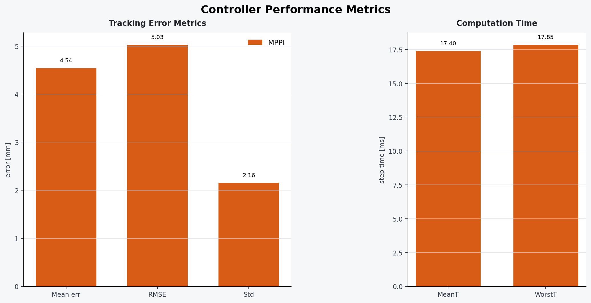

# UR5 Manipulator Control Simulation

UR5 6축 매니퓰레이터의 Cartesian 궤적 추종 성능을 시뮬레이션하고, **MPPI(Model Predictive Path Integral)**, **iLQR(iterative Linear Quadratic Regulator)**, **비선형 SQP(Sequential Quadratic Programming)** 제어기를 비교하는 프로젝트입니다. 외란, DOB(Disturbance Observer), 이동 장애물을 각각 켜고 끌 수 있으며 실행 결과를 수치 데이터, 정적 그래프, 3D 애니메이션으로 저장·표시합니다.

MPPI의 sampling, 사용자 정의 cost, importance-sampling 보정항과 DOB 모드별
차이는 [`docs/mppi_cost_function.md`](docs/mppi_cost_function.md)에 정리되어 있습니다.



## 주요 기능

- UR5의 6자유도 비선형 강체 동역학 시뮬레이션
- GPU 가속 MPPI, 반복 선형화 기반 iLQR, acados 기반 Full-SQP 제어
- 원(circle), 8자(infinity), 사각형(rectangle), 3D 파동(complex_3d_wave), 다중 스케일 3D(multiscale_3d) 말단 궤적 추종
- 정현파 토크 외란과 1차 Q-filter DOB 보상
- 기준 궤적 반대편에서 4.6배속으로 추격하는 10 mm 동적 정육면체 또는 기준 궤적에
  균등 배치되는 10 mm 정적 정육면체 장애물
- 단일 조건 실행 또는 다음 두 조건 비교
  - MPPI/iLQR/SQP 중 설정한 두 제어기
  - DOB OFF vs DOB ON
- 평균 오차, RMSE, 표준편차, 평균/최악 계산 시간 산출
- 실행별 폴더에 최종 YAML 설정, NPZ 결과, JSON 지표와 PNG 그래프 저장

## 모델과 제어기

시뮬레이션 플랜트와 세 제어기는 동일한 UR5 파라미터와 다음 동역학을 사용합니다.

```text
M(q)qdd + C(q, qd)qd + g(q) + Bqd = tau
```

- **MPPI**: `pytorch_mppi`를 이용해 토크 시퀀스를 샘플링하고, 말단 위치 추종·속도·입력·입력 변화·장애물 비용을 최소화합니다. rollout 동역학은 `torch.compile`로 컴파일되며 CUDA가 있으면 자동으로 GPU를 사용합니다.
- **iLQR**: UR5 비선형 동역학을 반복 선형화하고 Gauss-Newton 비용 근사와 line search로 토크 시퀀스를 갱신합니다. MPPI와 동일한 비용 항을 사용하되 가중치는 `cost.ilqr`에서 독립적으로 관리합니다. 예측에는 컴파일된 semi-implicit 적분을, 실제 플랜트에는 공통 RK4 적분을 사용하며 CPU `float64`로 실행합니다.
- **SQP**: CasADi로 비선형 OCP를 구성하고 acados의 Full-SQP 및 HPIPM QP solver로 풉니다. SQP 플랜트 계산은 CPU `float64`를 사용합니다.
- **DOB**: 측정 가속도와 nominal inverse dynamics로 외란 토크를 추정하고 제어 입력에 보상값을 더합니다.

기본 시뮬레이션은 제어 주기 20 ms, 총 10초(500 step), 예측 horizon 10으로 설정되어 있습니다. 실행·튜닝 설정은 `configs/*.yaml`에서 관리하고, `config.py`는 계산 모듈이 사용하는 런타임 상수를 제공합니다.

## 프로젝트 구조

```text
.
├── configs/                  # 기본값과 실행별 YAML 설정
├── main.py                   # run/compare/benchmark 통합 진입점
├── config.py                 # 모델 기본값과 계산 모듈 런타임 상수
├── execute.sh                # 환경변수 설정 후 main.py 실행
├── experiment_runner.py      # 공통 controller 실행 함수
├── controllers/
│   ├── mppi_dob_controller.py
│   ├── ilqr.py
│   └── sqp.py
├── dynamics/                 # UR5 순/역동역학 및 plant integration
├── kinematics/               # DH 기반 FK, Jacobian, IK
├── costs/                    # 추종 및 장애물 비용
├── observers/                # DOB 구현
├── utils/                    # 설정 파서, 궤적, 외란 생성기
├── visualization/            # 그래프와 3D 애니메이션
├── c_generated_code_ur5_sqp/ # acados 자동 생성·컴파일 결과
└── results/<timestamp>/      # 설정, 결과, 지표와 그래프를 묶은 실행 기록
```

## 실행 환경

현재 스크립트는 **Python 3.10**, PyTorch/CUDA 환경과 로컬 acados 소스 트리를 전제로 작성되어 있습니다.

### Python 패키지

가상환경을 만든 뒤 프로젝트 의존성을 설치합니다.

```bash
python3.10 -m venv .venv
source .venv/bin/activate
python -m pip install --upgrade pip
python -m pip install -r requirements.txt
```

`requirements.txt`에는 프로젝트가 직접 사용하는 NumPy, Matplotlib,
PyTorch, `pytorch_mppi`, CasADi, PyYAML만 명시되어 있습니다. SciPy,
`arm_pytorch_utilities`, CUDA runtime 등은 이 패키지들의 전이 의존성으로
설치됩니다. 설치 환경과 CUDA 버전에 맞는 PyTorch wheel이 필요한 경우에는
PyTorch를 먼저 별도로 설치하십시오.

### SQP 추가 의존성

SQP를 사용하려면 `requirements.txt`의 CasADi 외에도 빌드가 완료된 acados가
필요합니다. `acados_template`은 PyPI 의존성이 아니라 acados 소스 트리가
제공합니다. 현재 코드에는 개발 머신의 다음 경로가 기본값으로 들어 있습니다.

```text
/home/arclab-04/acados
/home/arclab-04/miniconda3/envs/mppi/lib/python3.10/site-packages
```

다른 머신에서는 다음 항목을 로컬 환경에 맞게 수정해야 합니다.

- [`execute.sh`](execute.sh)의 기본 `ACADOS_SOURCE_DIR`
- [`controllers/sqp.py`](controllers/sqp.py)의 `_CASADI_SITE`, `_ACADOS_PYTHON`, 기본 `ACADOS_SOURCE_DIR`
- 실행 전 `LD_LIBRARY_PATH=${ACADOS_SOURCE_DIR}/lib:${LD_LIBRARY_PATH}` 설정

`execute.sh`를 사용하지 않고 현재 가상환경의 Python으로 직접 실행할 수도 있습니다.

## YAML 설정과 실행

### GUI 실행

명령행 옵션 대신 GUI에서 실행 조건과 controller 파라미터를 선택할 수 있습니다.

```bash
python simulation_gui.py
# 또는 기존 실행 환경 설정을 함께 적용
./execute.sh gui
```

`execute.sh`는 현재 활성 환경의 `python`을 우선 사용합니다. shell에 `python`이
없으면 `/home/arclab-04/miniconda3/envs/manipulator/bin/python`으로 fallback합니다.
다른 interpreter를 사용하려면 `MANIPULATOR_PYTHON`에 실행 파일 경로를 지정합니다.

GUI는 단일 실행, controller/DOB 비교, benchmark를 지원합니다. 기존
`configs/*.yaml` preset을 불러오거나 현재 설정을 새 YAML로 저장할 수 있으며,
실제 계산은 별도 프로세스에서 `main.py`를 실행하므로 GUI의 로그와 중지 버튼을
계속 사용할 수 있습니다. 결과가 생성되면 GUI에서 timestamp 결과 폴더를 바로
열 수 있습니다.

GUI의 `Enable mean update`는 mean-sequence blending을 켜고 끕니다. 활성화할 때
사용되는 고정 alpha 값은 `simulation_gui.py`의 `GUI_MEAN_UPDATE_ALPHA`에서
수정하며, 비활성화하면 기존 MPPI와 동일한 `alpha=1.0`을 사용합니다.

설정은 물리 모델(`robot`, `simulation`), 제어기와 비용(`controller`,
`cost`), 실험 조건(`experiment`, `obstacle`, `comparison`, `benchmark`)으로
구분합니다. 모든 실행은 `configs/default.yaml`을 먼저 읽고 선택한 YAML과 CLI
인자를 차례로 덮어씁니다.

```text
기본값 < --config YAML < CLI 인자
```

알 수 없는 YAML 키, 잘못된 controller/obstacle mode, 잘못된 시간 간격은 실행
전에 오류로 처리됩니다. 기본 설정과 대표 설정은 다음 파일에 있습니다.

- `configs/default.yaml`
- `configs/mppi_baseline.yaml`
- `configs/mppi_static_obstacle.yaml`
- `configs/mppi_dynamic_obstacle.yaml`
- `configs/compare_mppi_ilqr.yaml`
- `configs/compare_mppi_sqp.yaml`
- `configs/compare_mppi_sqp_static_complex.yaml`
- `configs/compare_dob.yaml`
- `configs/benchmark_static.yaml`
- `configs/benchmark_hardware.yaml`
- `configs/benchmark_mean_update.yaml`
- `configs/mppi_mean_update_alpha09_tuned.yaml`

### 통합 진입점

```bash
python main.py run --config configs/mppi_static_obstacle.yaml
python main.py compare --config configs/compare_mppi_ilqr.yaml
python main.py compare --config configs/compare_mppi_sqp.yaml
python main.py benchmark --config configs/benchmark_static.yaml
python main.py benchmark --config configs/benchmark_hardware.yaml
python main.py benchmark --config configs/benchmark_mean_update.yaml
```

일부 값은 CLI에서 마지막으로 덮어쓸 수 있습니다.

```bash
python main.py run \
  --config configs/mppi_static_obstacle.yaml \
  --trajectory infinity \
  --seed 17 \
  --no-show
```

지원되는 공통 override는 `--trajectory`, `--seed`, `--duration`,
`--controller` (`mppi`, `ilqr`, `sqp`), `--obstacle`, `--[no-]disturbance`, `--[no-]dob`,
`--[no-]show`, `--[no-]torque-plot`입니다. `compare`에서
`comparison.type: controller`이면 MPPI와
`comparison.controllers`에 지정한 두 제어기를 비교하고, `dob`이면 선택한
controller의 DOB OFF/ON을 비교합니다.

각 관절에 실제로 적용된 토크와 토크 제한을 별도 시계열 그래프로 저장하려면
설정 파일에서 다음 옵션을 켭니다.

```yaml
output:
  torque_plot: true
```

또는 실행할 때 `--torque-plot`을 지정합니다. 활성화하면 실행 결과 폴더에
`joint_torques.png`가 추가되며, 비교 실행에서는 각 관절별로 제어기 토크가
겹쳐 표시됩니다.

GUI의 `Plot disturbance estimation error |d - d_hat|` 또는 CLI의
`--disturbance-error-plot`을 활성화하면 각 관절의
`tilde d = |d - d_hat|` 시계열이 `disturbance_estimation_error.png`로 저장됩니다.

메인 GUI/CLI에서 MPPI와 DOB를 켜면 기존 구조대로 optimizer 출력 뒤에
`d_hat`을 더하는 외부 후보상(`dob_compensation_mode="output"`)을 사용합니다.
DOB 추정값을 rollout 동역학의 `tau_effective = tau_sample - d_hat`에 반영하고
출력 후보상을 생략하는 방식은 테스트 전용입니다. 이 방식은
`benchmark_dob_rollout_comparison.py`와 `plot_dob_rollout_comparison.py`에서만
`dob_compensation_mode="rollout"`을 명시해 비교할 수 있습니다. SQP와 iLQR의
DOB 보상 구조는 이 실험 기능의 영향을 받지 않습니다.

### MPPI input-sequence mean update

`controller.mean_update_alpha`는 MPPI weighted-noise update에 CuRobo 방식의
mean blending을 적용합니다.

```text
U_candidate = U_warmstart + sum(weight * noise)
U_new = (1 - alpha) * U_warmstart + alpha * U_candidate
```

기본값 `1.0`은 기존 MPPI 동작을 그대로 보존합니다. `0.9`는 CuRobo의 기본
mean step과 같은 완화 비율입니다. 다음 benchmark는 Infinity 궤적에서
`alpha=1.0`과 `0.9`를 비교합니다. DOB OFF는 외란도 OFF, DOB ON은 외란도
ON으로 실행하며 tracking 및 연산시간과 연속 torque 변화량을 집계합니다.

```bash
python main.py benchmark --config configs/benchmark_mean_update.yaml
```

`output.torque_plot: true`이면 대표 seed의 결과가
`joint_torques_dob_off.png`와 `joint_torques_dob_on.png`로 저장됩니다.

### MPPI zero-initial input sequence 실험

Model-only DOB-aware 비교는 `python benchmark_model_only_mppi.py`로 실행한다.
`rollout_model_only`는 `rollout`의 명시적 이름이며 sampling 중심은
`U_ff + shifted residual`, prediction torque는 `clamp(U_sample)-d_hat`,
출력은 `clamp(u_mppi)`이다. 전용 benchmark는 CUDA 점검 후 Post-DOB,
model-only, nominal-shift를 같은 seed로 비교하고
`results/model_only_rollout_gpu/<fingerprint>/`에 보고서·시계열·그래프를 저장한다.
동일한 코드·설정·환경의 완전한 결과가 있으면 재사용한다.

후속 원인 분리 실험은 `python benchmark_model_only_ablation.py`로 실행한다.
Constant/step 외란에 대해 DOB/oracle 추정값, residual terminal zero/hold,
sample 수 136/544를 비교한다. Oracle은 정확한 현재 외란을 horizon 전체에
고정하는 진단 조건이다. 실제 사용한 추정값은 `d_hat_used`에 저장된다.
결과 JSON·NPZ와 tracking/diagnostics plot은
`results/model_only_ablation_gpu/<fingerprint>/`에 저장한다.
후속 실험의 MD 보고서는 요청할 때 작성하며 이 benchmark는 MD를 생성하지 않는다.

일반 실행의 기본 sampling center는 계속 `U_ff + shifted residual`이다. 비교용
`zero_initial_shift`는 첫 solve에서 absolute torque sequence 전체를 0으로 두고,
이후에는 직전 최적 sequence를 한 칸 shift한 뒤 마지막 입력을 0으로 채운다.
IK inverse-dynamics `U_ff`는 이 모드에서 reference 및 진단용으로만 계산되며
sampling center에는 들어가지 않는다. 외란 조건도 rollout 변경 없이 기존
Post-DOB 후보상을 사용한다.

GPU 사전 점검 후 circle 궤적의 명목/Post-DOB 조건을 3개 seed로 비교하고
보고서와 그래프를 생성하려면 다음을 실행한다.

```bash
conma
python benchmark_zero_initial_mppi.py
```

결과는 `results/mppi_zero_initial_gpu/`에 저장된다. 이 옵션은 실험 API에서
명시적으로 선택할 때만 활성화되며 GUI와 메인 실행 기본값에는 영향을 주지 않는다.

`alpha=0.9` 전용 순차 튜닝 결과는 기존 기본값을 변경하지 않고
`configs/mppi_mean_update_alpha09_tuned.yaml`에 분리되어 있습니다. Infinity 궤적,
장애물 없음 조건에서 temperature, noise variance, tracking/terminal weight,
smoothness weight, samples/horizon 순서로 탐색한 값입니다.

```bash
# DOB OFF / 외란 OFF
python main.py run --config configs/mppi_mean_update_alpha09_tuned.yaml

# DOB ON / 외란 ON
python main.py run --config configs/mppi_mean_update_alpha09_tuned.yaml \
  --dob --disturbance

# 튜닝 탐색과 3-seed 최종 비교 재실행
python tune_mean_update_mppi.py --output results/mean_update_tuning_alpha09

# 무장애/정적/동적 장애물 × 3개 외란/DOB 조건 일반화 검증
python benchmark_mean_update_generalization.py \
  --output results/mean_update_generalization_gpu_gtx1650 \
  --require-cuda
```

GTX 1650 CUDA에서 선택된 핵심 값은 `temperature=0.24`,
`noise_variance=[13.6, 23.8, 13.6, 2.72, 2.72, 0.85]`,
tracking/terminal weight `1200000/3600000`입니다. Smoothness weight `0.25`와
`K=136`, `T=10`은 기존값이 선택됐습니다.

가상환경을 활성화했다면 shell wrapper도 같은 인자를 그대로 전달합니다.

```bash
source .venv/bin/activate
./execute.sh run --config configs/default.yaml
```

`execute.sh`는 acados 관련 환경변수만 설정하며 설정 파일을 직접 해석하지 않습니다.
단일 실행, 비교와 benchmark의 유일한 사용자 진입점은 `main.py`입니다.

### MPPI GPU 하드웨어 비교

GTX 1650과 RTX 3050처럼 서로 다른 CUDA 장비의 MPPI 연산 속도는 각 장비에서
동일한 commit과 Python 환경으로 다음 명령을 한 번씩 실행해 측정합니다.

```bash
python main.py benchmark --config configs/benchmark_hardware.yaml
```

측정 전 두 장비 모두 AC 전원과 최고 성능 모드를 사용하고, 다른 GPU 작업을
종료하는 것이 좋습니다. `nvidia-smi`로 드라이버가 정상 인식되는지도 확인합니다.

이 설정은 Infinity 궤적, 장애물/외란/DOB 없음, tracking-only, 10초(500 step),
MPPI `K=136`, `T=10`을 seed 3개로 반복합니다. 커널 컴파일은 각 run의 제어
루프 전에 끝내며 JSON에는 실제 step 시간의 mean/median/p95/p99/worst,
20 ms deadline miss, tracking RMSE와 GPU·드라이버·CUDA 환경이 기록됩니다.
두 장비의 `metrics.json`을 한곳에 복사한 뒤 조건 검증과 속도비를 계산합니다.

```bash
python compare_hardware_mppi.py \
  results/gtx1650/metrics.json results/rtx3050/metrics.json \
  --output results/hardware_comparison.json
```

첫 MPPI 실행에서는 Torch/Inductor kernel 컴파일 때문에 초기 시간이 오래 걸릴 수 있습니다. 컴파일된 Inductor/Triton kernel은 `.torch_cache/`에 보관되어 이후 별도 프로세스에서도 재사용되며, 이 디렉터리는 Git에서 제외됩니다. 그래프나 실행 환경이 바뀌면 Torch가 새 cache key로 필요한 kernel만 다시 컴파일합니다. 커널 준비는 제어 루프 진입 전에 완료됩니다. measured solve에 남는 짧은 runtime/cache 안정화 구간이 `WorstT`와 시계열을 왜곡하지 않도록 첫 5개 제어 step은 `solve_t_raw`에만 보존하고 timing 통계와 그래프에서는 제외합니다.

iLQR도 prediction kernel과 전체 optimization 경로를 제어 루프 전에 한 번 실행해
lazy compilation 및 선형대수 초기화 시간을 제외합니다. 이 시간은 결과의
`warmup_t`에 별도로 저장됩니다. MPPI와 동일하게 첫 5개 measured solve는 raw
timing에 보존하되 `solve_t`와 성능 지표에서는 제외합니다.

SQP의 acados 생성 코드와 공유 라이브러리는 `c_generated_code_ur5_sqp/`에 보관되며 역시 Git에서 제외됩니다. 실행 시 현재 OCP와 캐시의 호환성을 검사해 일치하면 바로 재사용하고, 모델·horizon·비용·제약 등이 달라졌으면 자동으로 다시 생성하고 컴파일합니다. 실행 종료 시 Matplotlib 창이 열리고 `plt.show()`에서 대기하므로 GUI가 없는 환경에서는 적절한 Matplotlib backend 설정이 필요합니다.

## 결과

수치 결과에 영향을 주는 최종 설정, 실행 명령(`run`, `compare`, `benchmark`),
DOB 보상 방식, 수치 실행 코드와 CPU/GPU 환경으로 result fingerprint를 만듭니다.
동일 fingerprint의 완전한 결과가 이미 있으면 시뮬레이션과 추가 저장을 건너뛰고
기존 결과 경로를 출력합니다. Seed도 fingerprint에 포함되므로 독립 반복 실험은
seed를 변경해야 합니다. `output.root`, 화면 표시와 plot 선택처럼 수치 결과를
바꾸지 않는 출력 옵션은 중복 판정에서 제외됩니다.

새로운 실행 조건일 때만 timestamp별 독립 디렉터리에 최종 병합 설정과 결과를
함께 저장합니다.

```text
results/
├── legacy_data/              # 이전 data/ 실행 결과 보존본
└── 20260827_153500_123456/
    ├── config.yaml
    ├── run_manifest.json
    ├── results.npz
    ├── metrics.json
    ├── final_trajectory.png
    ├── timeseries.png
    └── metrics_dashboard.png
```

`config.yaml`은 기본값, 선택한 설정 파일과 CLI override를 모두 반영한 실제 최종
설정입니다. NPZ에는 관절 상태(`q`), 말단 위치(`ee`), 입력 토크(`u`), 추종
오차, 외란/DOB 신호와 step 계산 시간이 포함됩니다. 비교 실행의 NPZ key에는
controller case 이름이 prefix로 붙습니다. 결과 루트는 YAML의 `output.root`로
변경할 수 있습니다. `c_generated_code_ur5_sqp/`는 SQP solver 생성 과정에서
갱신될 수 있습니다.

## 주요 설정값

| 항목 | 기본값 |
|---|---:|
| 시뮬레이션 시간 / 제어 주기 | 10 s / 0.02 s |
| 총 step | 500 |
| MPPI/iLQR/SQP horizon | 10 |
| MPPI sample 수 | 136 |
| MPPI temperature `lambda` | 0.2 |
| iLQR 최대 반복 횟수 | 2 |
| 기준 궤적 중심 | `[0.40, 0.00, 0.35]` m |
| 기준 궤적 반경 | 0.13 m |
| 관절 속도 제한 | ±6 rad/s |
| DOB cutoff 계수 `alpha` | 40 |

토크 제한은 1~3번 관절 ±150 Nm, 4~6번 관절 ±28 Nm입니다. 물리·제어 파라미터를 변경할 때는 MPPI, iLQR, SQP가 모두 [`config.py`](config.py)의 값을 공유한다는 점을 고려하십시오.
